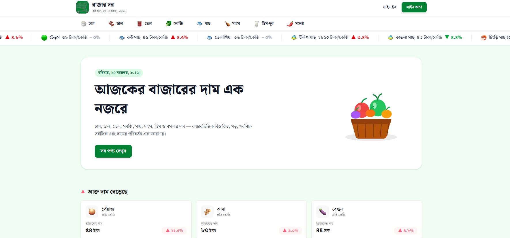

<div align="center">

# 🛒 বাজার দর (BazarDor)

**প্রয়োজনীয় পণ্যের দাম এক নজরে**

A Bangla grocery price tracker that shows today's market prices of everyday essentials, how they changed since yesterday, and a market-by-market price breakdown.

<p>
  
  
  
  
  
</p>

[Live Website](https://assignment-seven-bazardor.vercel.app/) · [GitHub Repository](https://github.com/AkramMdkhan/assignment-seven-bazardor) 

<br/>



</div>

---

## 📖 About

**BazarDor (বাজার দর)** helps people check the daily price of rice, lentils, oil, vegetables, fish, meat, eggs, milk and spices in one place. Every product shows today's price in Bengali digits, a rise/fall badge compared with yesterday, and detailed minimum, maximum and average prices from different markets.

Visitors can browse the home page and category pages freely. Signing in unlocks the detailed price page of each product.

---

## ✨ Key Features

1. **Secure authentication**
   Sign up and sign in with email and password, or continue with **Google** or **GitHub**. Built with Better Auth and MongoDB Atlas, with clear toast messages for success, errors and validation.

2. **Protected product details**
   Each product page (`/product/[slug]`) needs a login. Logged-out visitors are redirected to sign in with a helpful message, and are sent back to the page they wanted after logging in.

3. **Detailed market price breakdown**
   Every product shows today's price, the change from yesterday (▲ / ▼ / —), minimum, maximum and average prices, and a table of prices across different markets and divisions.

4. **Category pages with price sorting**
   Browse products by category and sort them with the **সাজান** dropdown: **ডিফল্ট**, **দাম: কম থেকে বেশি**, **দাম: বেশি থেকে কম**. Prices are sorted by their numeric value and shown in Bengali digits.

5. **Profile and update information**
   A personal **My Profile** page shows the account details, with an update button that opens a separate page to change the name and profile photo through Better Auth's `updateUser`.

**Also included:** skeleton loaders, a friendly 404 page with a "হোম পেজে ফিরে যান" button, a fully responsive design for mobile, tablet and desktop, and `/signin` and `/signup` shortcuts for the auth pages.

---

## 🧰 Technologies Used

| Area | Technology |
| --- | --- |
| Framework | [Next.js 16](https://nextjs.org/) (App Router, React Compiler) |
| Language | TypeScript, React |
| Styling | Tailwind CSS, DaisyUI |
| Authentication | [Better Auth](https://better-auth.com/) (email/password, Google, GitHub) |
| Database | MongoDB Atlas |
| Notifications | react-toastify |
| Route protection | Next.js `proxy.ts` |
| Deployment | Vercel |

---

## 📦 Dependencies

| Package | Purpose |
| --- | --- |
| `next`, `react`, `react-dom` | Core framework |
| `better-auth` | Authentication |
| `mongodb` | Database driver |
| `tailwindcss`, `daisyui` | Styling and UI components |
| `react-toastify` | Toast notifications |
| `babel-plugin-react-compiler` | React Compiler |

See [`package.json`](./package.json) for the complete list.

---

## 🚀 Getting Started

### Prerequisites

- [Node.js](https://nodejs.org/) 18 or later
- A [MongoDB Atlas](https://www.mongodb.com/atlas) connection string
- Google and GitHub OAuth credentials (only needed for social login)

### 1. Clone the repository

```bash
git clone https://github.com/AkramMdkhan/assignment-seven-bazardor.git
cd assignment-seven-bazardor
```

### 2. Install dependencies

```bash
npm install
```

### 3. Set up environment variables

Create a `.env.local` file in the project root:

```env
MONGODB_URI=your_mongodb_atlas_connection_string
BETTER_AUTH_SECRET=your_long_random_secret
BETTER_AUTH_URL=http://localhost:3000

GOOGLE_CLIENT_ID=your_google_client_id
GOOGLE_CLIENT_SECRET=your_google_client_secret
GITHUB_CLIENT_ID=your_github_client_id
GITHUB_CLIENT_SECRET=your_github_client_secret
```

### 4. Run the development server

```bash
npm run dev
```

Open [http://localhost:3000](http://localhost:3000) in your browser.

---

## 🗺️ Main Routes

| Route | Description | Access |
| --- | --- | --- |
| `/` | Home page | Public |
| `/category/[slug]` | Products of a category, with sorting | Public |
| `/product/[slug]` | Product price details | 🔒 Login required |
| `/sign-in` (`/signin`) | Sign in | Public |
| `/sign-up` (`/signup`) | Sign up | Public |
| `/profile` | My profile | 🔒 Login required |
| `/profile-update` | Update name and photo | 🔒 Login required |

---

## 🔗 Links

- **Live Website:** https://assignment-seven-bazardor.vercel.app
- **GitHub Repository:** https://github.com/AkramMdkhan/assignment-seven-bazardor
- **Portfolio:** https://akram-mohammad-khan-portfolio.vercel.app

---

## 📜 Notes

- All prices are estimates and may change depending on market conditions.
- Email verification and password reset are intentionally not included.

---

## 👤 Author

**Akram Mohammad Khan**, MERN Stack Developer

[GitHub](https://github.com/AkramMdkhan) · [LinkedIn](https://www.linkedin.com/in/akrammdkhan)

<div align="center">

Made with ❤️ for the Bangladeshi market

</div>
